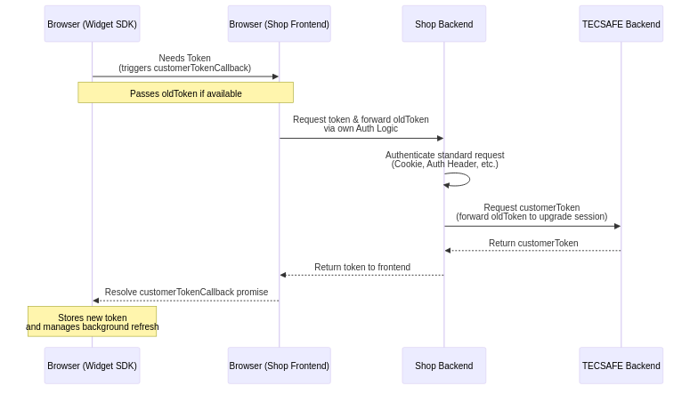

# Widget SDK

The TECSAFE Widget SDK embeds TECSAFE widgets (product configurator, layout editor and project app)
and handles iframe communication and customer JWT management. The full API documentation is
available at [tecsafe.github.io/widget-sdk](https://tecsafe.github.io/widget-sdk).

## Installation

```bash
npm install @tecsafe/widget-sdk
```

> ⚠️ **Register all required event handlers before starting any widget.** Register them on the manager
> immediately after construction, before calling `createProductDetailWidget()`,
> `createCustomPageWidget()` or `openFullScreen()`. These methods throw if a required handler is
> missing. See [Required event handlers](#required-event-handlers) for the complete list and responses.

## Initializing the SDK

Instantiate one `TecsafeWidgetManager` per page, after obtaining any required customer consent.
The constructor takes two arguments: a customer token callback and a `WidgetManagerConfig`.
Cart operations use the event API described below.

```typescript
import { TecsafeWidgetManager, WidgetManagerConfig } from '@tecsafe/widget-sdk'
import { registerShopEvents } from './tecsafe-events'

const manager = new TecsafeWidgetManager(
  async (oldToken?: string) => {
    const response = await fetch('/tecsafe/saleschannel-customer-token', {
      method: 'POST',
      headers: { 'Content-Type': 'application/json' },
      body: JSON.stringify({ oldToken }),
    })
    if (!response.ok) throw new Error('Could not obtain the customer token')
    const json = await response.json()
    return json.token
  },
  new WidgetManagerConfig({
    trackingAllowed: true, // Set according to the customer's consent.
    language: 'en-US',
    currencyCode: 'EUR',
    priceMode: 'gross',
    taxCategories: { S: 19, AA: 7 },
    tecsafeArticles: [{ productNumber: 'TS-1', price: '59.50' }],
  })
)

// Required: register all three handlers before starting widgets.
// Implemented in tecsafe-events.ts below.
registerShopEvents(manager)

const container = document.getElementById('product-detail-widget')
if (!container) throw new Error('Widget container not found')
const widget = manager.createProductDetailWidget(container, 'SKU-123456')
```

### Required event handlers

The manager requires an active handler for each of these requests:

| Request to handle                                                    | Response to send                                                                                   |
| -------------------------------------------------------------------- | -------------------------------------------------------------------------------------------------- |
| `IN_MESSAGES.InMessageRequestArticleInfo` (`request-article-info`)   | `OUT_MESSAGES.OutMessageArticleInfo` (`article-info`), once per requested article                  |
| `IN_MESSAGES.InMessageRequestLayoutPrices` (`request-layout-prices`) | `OUT_MESSAGES.OutMessageLayoutPrices` (`layout-prices`), echoing `requestId`                       |
| `IN_MESSAGES.InMessageCartPunchout` (`cart-punchout`)                | `OUT_MESSAGES.OutMessageCartPunchoutResult` (`cart-punchout-result`), once for the entire transfer |

Always initialize the integration in this order:

1. Construct the manager with the token callback and configuration.
2. Register all three handlers with `manager.on(...)` using the
   [shop integration example](#shop-integration-example).
3. Create the product/custom-page widget or open fullscreen.

Register the handlers synchronously, even when the handlers themselves perform asynchronous work.
A fullscreen URL restored on page load opens in a microtask after construction, so register handlers
immediately after constructing the manager, before an `await` or other deferred setup.

`createProductDetailWidget()`, `createCustomPageWidget()` and `openFullScreen()` validate the required
handlers on every call, before creating or opening the widget. Missing handlers cause an `Error`
listing **every missing event** and explaining how to register them. For example:

```text
Missing required event handlers: cart-punchout, request-article-info, request-layout-prices. Register each handler with manager.on(IN_MESSAGES.<message>, handler) before creating or opening a widget.
```

Use `on()` for persistent integrations. If the last handler is removed with `off()` or consumed by
`once()`, register it again before starting another widget. Keep the handlers registered while
widgets are running so requests can still be processed. Registration is required even when there
are no matching articles or the host cart is unavailable: respond with `info: null` or
`{ success: false }` as appropriate.

The debug console created by `createDebugWidget()` is exempt from these business-event checks so
it can be used to troubleshoot an incomplete integration. It still requires `debugWidget: true`.

## Widget events

`IN_MESSAGES` contains requests from widgets to the host shop. `OUT_MESSAGES` contains messages
from the host shop to widgets. The SDK handles internal messages such as token requests itself.
Business events must be handled by your application. Reply with `e.respond(...)` to target the
requesting widget; `manager.emit(...)` broadcasts to all widgets.

### Shop integration example

Create `tecsafe-events.ts` with your application's event handlers. The example endpoints below
represent routes you implement in your own backend. They must authenticate the customer and apply
your shop's pricing and cart rules.

```typescript
import {
  TecsafeWidgetManager,
  IN_MESSAGES,
  OUT_MESSAGES,
  ArticleInfo,
  LayoutPricesResponse,
} from '@tecsafe/widget-sdk'

export function registerShopEvents(manager: TecsafeWidgetManager): void {
  manager.on(IN_MESSAGES.InMessageRequestArticleInfo, async (e) => {
    await Promise.all(
      e.event.articles.map(async (article) => {
        const response = await fetch('/tecsafe/article-info', {
          method: 'POST',
          headers: { 'Content-Type': 'application/json' },
          body: JSON.stringify(article),
        })
        const info: ArticleInfo | null = response.ok
          ? await response.json()
          : null
        // Echo the complete identifier, including every supplied field.
        e.respond(OUT_MESSAGES.OutMessageArticleInfo.create({ article, info }))
      })
    )
  })

  manager.on(IN_MESSAGES.InMessageRequestLayoutPrices, async (e) => {
    const response = await fetch('/tecsafe/layout-prices', {
      method: 'POST',
      headers: { 'Content-Type': 'application/json' },
      body: JSON.stringify(e.event),
    })
    if (!response.ok) throw new Error('Could not calculate layout prices')
    const prices: LayoutPricesResponse = await response.json()
    // The backend must preserve requestId and serviceIds.
    e.respond(OUT_MESSAGES.OutMessageLayoutPrices.create(prices))
  })

  manager.on(IN_MESSAGES.InMessageCartPunchout, async (e) => {
    let success = false
    try {
      const response = await fetch('/tecsafe/cart-punchout', {
        method: 'POST',
        headers: { 'Content-Type': 'application/json' },
        body: JSON.stringify(e.event),
      })
      success = response.ok // Return success only when the complete cart transfer succeeded.
    } catch {
      // Report transport failures to the widget too.
    }
    e.respond(OUT_MESSAGES.OutMessageCartPunchoutResult.create({ success }))
  })
}
```

### Article information

Each `request-article-info` payload contains `articles: ArticleIdentifier[]`. An identifier contains
at least one of `gtin`, `manufacturerArticleNumber` or `supplierArticleNumber`.
Reply once per requested article with `{ article, info }`. Send `info: null` when details are
unavailable so the widget can show its fallback promptly.

```typescript
const info: ArticleInfo = {
  hostShopArticleNumber: 'HOST-123', // Used in cart punchout.
  availableStock: true, // Optional; omit when availability is unknown.
  taxCategory: 'AA',
  priceScales: [
    {
      fromQuantity: 1,
      unitPrice: '38.50',
      allowancesAndCharges: [
        { reasonText: 'Summer-Rebate', type: 'percentage', value: '5' },
      ],
      effectiveUnitPrice: '36.58',
    },
  ],
  images: ['https://shop.example/product.png'],
  downloads: ['https://shop.example/manual.pdf'],
}
```

Images and downloads are optional arrays of URL strings. Protect your article lookup API with
appropriate rate limits.

### Layout prices and session settings

`request-layout-prices` contains a `requestId`, `layout` with `priceScales` and `taxCategory`, and
`tecsafeServices`. Each service includes its ID, localized title, category, mandatory flag, tax
category, and unit pricing. The incoming TECSAFE prices are always **net EUR**, including any
TECSAFE allowances and charges.

Reply with `layout-prices`, preserving `requestId` and each service's `serviceId`. Convert the
layout's quantity scales and service prices for the current customer. Preserve existing allowances
and charges and include any shop adjustments. Service responses require pricing and the service ID;
titles, categories and mandatory flags do not need to be repeated.

Article info, layout price responses and cart punchout use the session's configured `currencyCode`,
`priceMode` (`gross` or `net`) and tax categories. Tax category codes such as `S` and `AA` refer to
`taxCategories`; shop-specific codes can be configured in `additionalTaxCategories`. When returning
gross layout prices, include the corresponding `taxCategory` on the layout and services. Configure
these session settings consistently with the widget's init configuration. Prices and tax settings
are assumed to agree with that configuration; they are not independently negotiated in each event.

Monetary unit prices and adjustment values use decimal strings. Every quantity scale contains
`fromQuantity`, `unitPrice`, `allowancesAndCharges`, and `effectiveUnitPrice`.

### Cart punchout

`cart-punchout` replaces the previous constructor callback and `add-to-cart`/`added-to-cart` messages.
It carries `{ positions, tecsafeTotal }`. Each position includes:

- An opaque `positionId`, its `parentPositionId` (null for a layout), and a type:
  `layout`, `tecsafeService`, or `hostShopArticle`.
- Article `identifiers`, localized `description`, and a `quantity` with its relation to its parent
  (`per-parent-unit`, `once-per-parent`, or `independent`), value, total and unit of measure.
- `pricing` with unit price, allowances and charges, effective unit price, and line amount;
  plus its `taxCategory`.
- Optional `meta`, including material dimensions and colors, image URLs and item counts.

`tecsafeTotal` is a number; position quantities and monetary amounts are strings. The exported
`CartPunchoutRequest` and `CartPunchoutPosition` types describe the complete payload.
Respond once with `OUT_MESSAGES.OutMessageCartPunchoutResult.create({ success })` after processing
the entire transfer. The response is a normal widget event; it carries no HTTP status code.

## Migrating an existing integration

Update existing integrations for these API changes:

- Construct the manager with `(customerTokenCallback, widgetManagerConfig)`. The constructor cart
  callback and the `SingleAddToCartHandler` / `BulkAddToCartHandler` exports have been removed.
- Replace `add-to-cart` / `added-to-cart` with the complete `cart-punchout` /
  `cart-punchout-result` exchange, and register all three required event handlers before starting
  widgets.
- Use `language`, `currencyCode` and `priceMode: 'gross' | 'net'` instead of `languageRFC4647`,
  `currencyCodeISO4217` and `taxIncluded`. Supply the required `taxCategories` (`S` and `AA`) and
  `tecsafeArticles` array; use an empty array if the shop lists no TECSAFE articles.
- Replace article identifier `ean` with `gtin`. Identifiers also support
  `manufacturerArticleNumber` and `supplierArticleNumber`. Keep the `{ article, info }` response
  wrapper and echo all fields of the requested identifier.
- Update article info to use `hostShopArticleNumber`, optional `availableStock`, `taxCategory`, and
  `priceScales`. A single `price` or numeric `stock` no longer matches the response contract.
- Use each message definition's `preset()` for debug payloads. The old `MESSAGE_PRESETS` map is no
  longer exported.

## Customer tokens

Your token callback should call an authenticated route in your backend. That route requests a
customer token from TECSAFE's
[/jwt/saleschannel-customer endpoint](https://ofcp-api-gateway.staging.tecsafe.de/api#/Auth%20controller/AuthController_loginSaleschannelCustomer_v1).
Forward the callback's `oldToken` to TECSAFE when present so guest assets and customer sessions can
be merged or upgraded correctly. The customer user ID must be unique within your sales channel;
search tags can be used for customer groups and access rights.

When the customer's login status changes, refresh the token:

```typescript
await manager.refreshToken()
// Or provide a token already fetched by your application:
await manager.refreshToken('<new-token>')
```

The SDK caches tokens, refreshes them before expiry, and propagates new tokens to its widgets.



## Cleanup and SPA lifecycle

Destroy the widget when leaving a page, or destroy all widgets when withdrawing consent or
unmounting the integration. `destroyAll()` also clears token refresh timers and removes the debug
overlay. Manager event registrations remain available if the manager is reused.

```typescript
widget.destroy()
// Or:
await manager.destroyAll()
```

For Vue, reuse the token callback, configuration and `registerShopEvents` above:

```html
<template>
  <div ref="container" />
</template>

<script lang="ts" setup>
  import { onMounted, onBeforeUnmount, ref } from 'vue'
  import { TecsafeWidgetManager } from '@tecsafe/widget-sdk'
  import { registerShopEvents } from './tecsafe-events'
  import { tokenCallback, widgetConfig } from './tecsafe-config'

  const container = ref<HTMLElement | null>(null)
  let manager: TecsafeWidgetManager | null = null

  onMounted(() => {
    if (!container.value) throw new Error('Widget container not found')
    manager = new TecsafeWidgetManager(tokenCallback, widgetConfig)
    registerShopEvents(manager) // Register every required event before creating the widget.
    manager.createProductDetailWidget(container.value, 'SKU-123456')
  })

  onBeforeUnmount(() => {
    void manager?.destroyAll()
  })
</script>
```

## Debug tooling

Two development helpers are available through `WidgetManagerConfig`: `debugWidget: true` enables
`createDebugWidget(element)`, and `sdkDebugger: true` injects a collapsible communication overlay.
Both default to false and should be disabled in production.

The debug widget can be created without business event handlers to troubleshoot an integration.
Calling `createDebugWidget()` without the configuration flag throws an error.

The overlay logs incoming and outgoing messages, can send arbitrary messages to a selected widget,
and can reset a widget. It uses a shadow root, and `destroyAll()` removes it.
Every message definition in `IN_MESSAGES` and `OUT_MESSAGES` exposes a `preset()` function for debug
payloads; payload-free messages return null.

```typescript
const example = OUT_MESSAGES.OutMessageLayoutPrices.preset()
```
